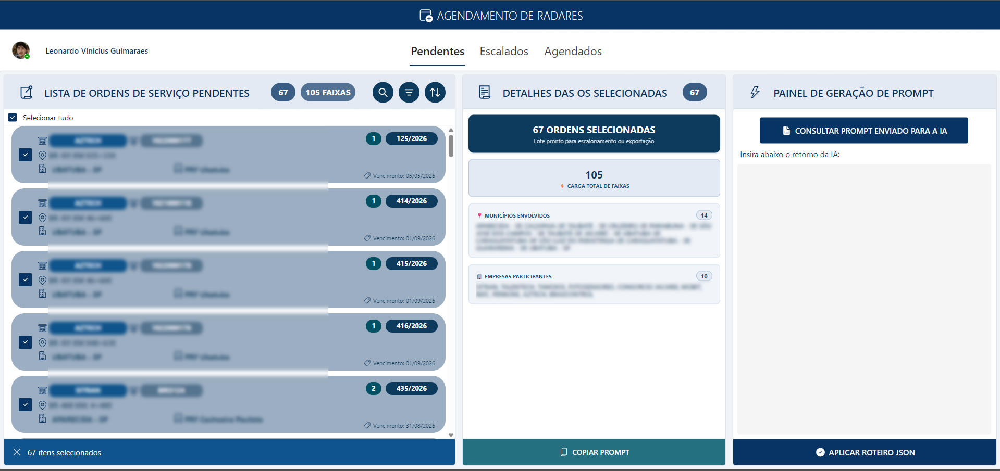
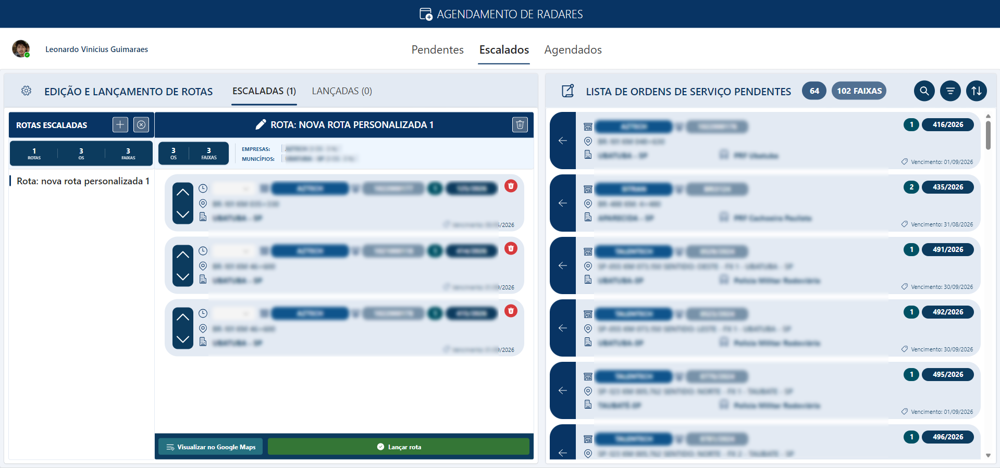
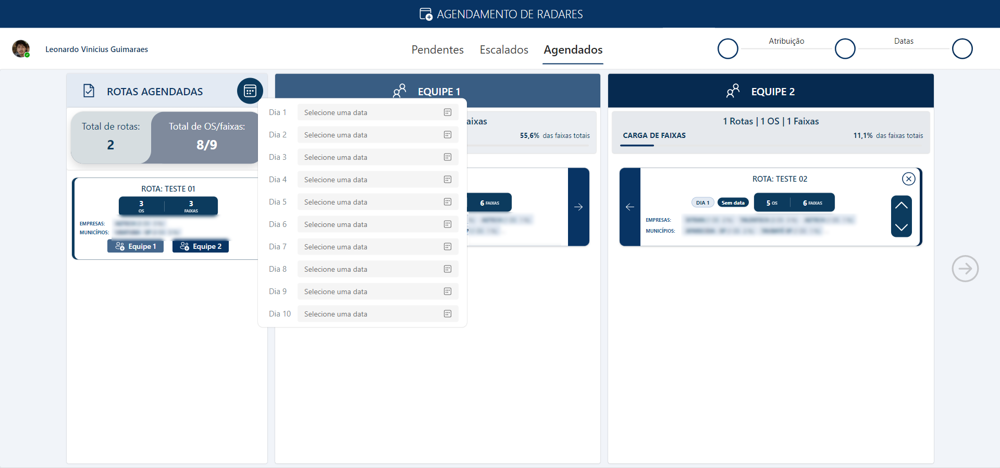

# 📍 Agendamento e Organização de Radares (Power Platform)

Solução corporativa desenvolvida em **Microsoft Power Apps (Canvas / Power Fx)** integrada a **SharePoint Lists**, **Power Automate**, **Microsoft Forms** e **Microsoft Teams**, focada na digitalização do fluxo de ordens de serviço (OS) e na assistência ao planejamento logístico de rotas com apoio de IA (Google Gemini Flash) e validação geográfica.

---

## 🎯 Contexto e Objetivo Central

O objetivo final de todo o processo de planejamento é gerar as **tabelas consolidadas de programação (Excel)**:
* A agenda individualizada de trabalho para as **duas equipes técnicas** de campo.
* A grade de agendamento por **empresa operadora**, que deve ser enviada para aprovação prévia das concessionárias antes da execução dos serviços.

### O Cenário Anterior
* **Operação Fragmentada e Analógica:** As empresas enviavam as ordens de serviço por e-mail sem padronização.
* **Manipulação em Papel:** As OSs eram impressas e organizadas fisicamente em pastas.
* **Planejamento Manual:** A coordenação precisava consultar endereços um a um na internet para montar os trajetos e preencher manualmente as planilhas de envio.
* **Falta de Acompanhamento em Tempo Real:** Uma vez em campo, o controle de quais instrumentos foram efetivamente verificados dependia de retornos tardios e anotações avulsas.

### O Que a Solução Entregou
* **Geração Ágil da Grade:** A montagem das rotas e a consolidação dos dados para envio às empresas e às equipes passou a ser feita de forma rápida e digital.
* **Eliminação do Papel:** Centralização de todas as solicitações em ambiente seguro e estruturado na nuvem.
* **Gestão Ativa da Execução:** Além de planejar, o sistema permite acompanhar digitalmente o andamento diário das fiscalizações em tempo real (marcando status como Executado, Pendente ou Reagendado).

## 🔄 Fluxo Operacional de Ponta a Ponta

O sistema funciona de forma integrada, equilibrando automação em segundo plano com tomada de decisão humana:

```text
[1. Recepção de E-mail & Submissão via Microsoft Forms]
               ⬇
[2. Armazenamento na Lista de Pré-Pendentes (Camada de Segurança)]
               ⬇
[3. Power Automate 1: Transfere registros para a Lista de Pendentes]
               ⬇
[4. Seleção de Pendentes no Power Apps & Extração do Prompt Sanitizado]
               ⬇
[5. Processamento no Gemini Flash ➔ Retorno em JSON Cru]
               ⬇
[6. Ingestão via ParseJSON no App & Edição Manual Fina (Criar/Excluir/Reordenar)]
               ⬇
[7. Validação Cartográfica Visual via URL Multi-waypoint do Google Maps]
               ⬇
[8. Distribuição entre as 2 Equipes Técnicas & Definição de Datas]
               ⬇
[9. Power Automate 2: Consolidação dos Itens na Lista de Agendados]
               ⬇
[10. Gestão Contínua da Agenda no SharePoint/Teams (Executado/Pendente/Reagendado)]
```

### 1. Ingestão e Triagem com Forms e Automate
* O operador recebe a solicitação por e-mail e faz o lançamento padronizado via **Microsoft Forms**.
* O Forms alimenta uma lista de **Pré-Pendentes** no SharePoint, garantindo que inconsistências não entrem diretamente na fila oficial.
* O **Power Automate (Fluxo 1)** valida e transfere as OSs aprovadas para a lista oficial de **Pendentes**, onde ficam acumuladas até o ciclo de agendamento.

### 2. Geração de Rascunho com IA & Proteção de Dados
* A equipe acessa o Power Apps, filtra as OSs pendentes e seleciona o lote de trabalho.
* O aplicativo compila os metadados selecionados em um prompt logístico padronizado.
* **Segurança e Minimização de Dados (LGPD):** A rotina no Power Apps aplica **sanitização estrita** aos dados antes de montar o payload. São trafegados unicamente metadados técnicos e logísticos dos instrumentos (número da OS, trecho viário/rodovia, município, volume de faixas e empresa operadora). Nomes de fiscais, contatos de técnicos, CPFs ou dados sigilosos/financeiros nunca são expostos ou enviados à IA.
* O prompt é processado no **Gemini Flash**, que devolve um array JSON cru com a primeira proposta de agrupamento de rotas e ordem de atendimento.

### 3. Edição Manual Fina
* O retorno JSON é ingerido diretamente no aplicativo via `ParseJSON`.
* A partir daqui, a edição é **100% manual e humana**: o operador pode criar novas rotas, excluir paradas e reordenar a sequência de visitação (`Ordem_Agendamento`) para corrigir desvios deixados pela IA.
* **Validação Cartográfica:** O operador abre o trajeto no Google Maps através de links dinâmicos multi-waypoint para conferir visualmente a viabilidade do percurso antes de fechar a rota.

### 4. Alocação por Equipes, Fechamento e Gestão Contínua
* As rotas finalizadas são distribuídas entre as **duas equipes técnicas de campo** e têm seus dias de execução definidos.
* O **Power Automate (Fluxo 2)** pega os itens agendados da lista de Pendentes e os transfere de forma consolidada para a lista definitiva de **Agendados**.
* A lista de Agendados (acessível via SharePoint e abas do **Microsoft Teams**) passa a ser o painel vivo de controle diário: a equipe acompanha a execução, aponta OSs como **Executadas**, trata **Pendências** e realiza eventuais **Reagendamentos**.

---

## 🤖 Engenharia de Prompt & Uso da IA

O modelo de linguagem atua como um assistente heurístico que cria o primeiro esboço de trajeto a partir de restrições operacionais conhecidas.

> 🔒 **Garantia de Privacidade e Conformidade (LGPD):**
> * **Zero Dados Pessoais:** O pipeline bloqueia intencionalmente qualquer dado pessoal ou institucional sigiloso.
> * **Metadados Públicos:** Todos os pontos analisados tratam exclusivamente de instrumentos de medição situados em vias públicas.
> * **Operação Transiente:** O envio destina-se unicamente ao cálculo da ordem sequencial no retorno JSON, sem armazenamento ou retenção de dados em serviços externos.

> ⚠️ **Nota:** A engenharia de prompt está em **constante evolução e refinamento**. Ajustes contínuos são realizados para adequar a interpretação do modelo às particularidades geográficas da região e às mudanças de diretrizes operacionais. Atualmente, o processamento é executado no **Gemini Flash**.

<details>
<summary>📋 <strong>Clique para ver a estrutura atual do Prompt de Roteirização</strong></summary>

```text
Atue como um Roteirizador Logístico de Operações e Especialista em Planejamento. Sua função é analisar uma lista de Ordens de Serviço (OS) e organizá-la em rotas otimizadas.

Siga ESTRITAMENTE as regras logísticas estabelecidas: tempo de execução de 20 min/faixa, jornada 08h30-16h00 sem pernoite ou até 17h00 com pernoite, regras de diárias apenas em cidades permitidas, agrupamento inquebrável por Empresa e Rodovia, máximo de 4h ativas de deslocamento.

1. Parâmetros de Tempo e Jornada de Trabalho (REGRA CRÍTICA)
- Tempo de Execução e Deslocamento: Cada 'Faixa' leva 20 minutos de execução. O cálculo do dia deve somar isso ao trajeto real. Reduza o volume de faixas se houver muitas trocas de rodovia/município.
- Jornada Padrão (Sem Pernoite): Saída de SJC às 08h30 e retorno impreterivelmente até as 16h00 (descontando 1h30 de almoço).
- Jornada Estendida (Com Pernoite/Diária): Se houver pernoite no destino, a janela estende-se até as 17h00.
- Equilíbrio de Carga em Viagens Longas: Em rotas que envolvam pernoite por múltiplos dias, distribua as faixas equilibradamente entre os dias usando empresas como delimitadores de bloco.

2. Lógica de Deslocamento, Base e Cidades de Pernoite
- Base Operacional: Partida e retorno na R. Sebastião Humel, 759 - Centro, São José dos Campos - SP.
- Cidades Permitidas para Diária/Pernoite: Aparecida, Arapeí, Areias, Bananal, Cachoeira Paulista, Campos do Jordão, Canas, Caraguatatuba, Cruzeiro, Cunha, Guaratinguetá, Lagoinha, Lavrinhas, Lorena, Natividade da Serra, Piquete, Potim, Queluz, Redenção da Serra, Santo Antônio do Pinhal, São Bento do Sapucaí, São José do Barreiro, São Luís do Paraitinga, Silveiras e Ubatuba.
- Cidades Sem Diária: Só entram em rotas com pernoite se estiverem estritamente no trajeto de ida ou retorno à base de São José dos Campos.

3. Consolidação e Agrupamento
- Unificação de Rodovias: Agrupe todas as OSs da mesma rodovia operadas pela mesma empresa. Não fragmente a mesma via em rotas distintas.
- Prioridade de Agrupamento: 1º Empresa, 2º Localização física sequencial lógica (sem zigue-zague).
- Proibição de Rotas Isoladas: Nunca crie uma rota para apenas 1 OS ou pouquíssimas faixas periféricas; incorpore-as ao fluxo de ida/volta de rotas de pernoite.

4. Nomenclatura das Rotas
- Cada rota diária ou viagem deve receber um identificador textual claro no campo 'rota_nome', por exemplo: 'Rota 01', 'Rota 02', etc.

---
Lista de Ordens de Serviço para Roteirização:
<<LISTA_AQUI>>
---

FORMATO DE SAÍDA EXIGIDO (JSON ESTRITO):
Retorne EXCLUSIVAMENTE o array JSON cru, sem marcações markdown e sem textos adicionais. Chaves obrigatórias por objeto:
- "Numero_OS": (string) O 'Nº da OS' idêntico ao fornecido.
- "rota_nome": (string) O identificador da rota atribuída (Ex: "Rota 01").
- "Ordem_Agendamento": (número) A sequência de atendimento dentro da rota (1, 2, 3...).
- "Status": (string) Valor fixo "Escalado".

Exemplo de saída esperada:
[
  { "Numero_OS": "463/2026", "rota_nome": "Rota 01", "Ordem_Agendamento": 1, "Status": "Escalado" },
  { "Numero_OS": "464/2026", "rota_nome": "Rota 01", "Ordem_Agendamento": 2, "Status": "Escalado" }
]
```

</details>

## 🛠️ Tecnologias Utilizadas

| Tecnologia | Função no Projeto | 
| ----- | ----- | 
| **Microsoft Forms** | Formulário de entrada padronizada para OSs recebidas por e-mail | 
| **Microsoft SharePoint Lists** | Arquitetura de 3 listas para controle de integridade (Pré-Pendentes, Pendentes e Agendados) | 
| **Microsoft Power Automate** | Automação da migração (Pré-Pendentes ➔ Pendentes) e consolidação pós-agendamento (Pendentes ➔ Agendados) | 
| **Microsoft Power Apps (Canvas)** | Interface visual de triagem, editor manual de rotas, balanceador de equipes e calendário operacional | 
| **Microsoft Teams** | Hub central que integra o aplicativo, listas e painel de agenda para operação colaborativa | 
| **Google Gemini Flash** | Geração do rascunho inicial das rotas estruturado em JSON a partir de restrições operacionais | 
| **Google Maps (URL Multi-waypoint)** | Validação cartográfica visual dos itinerários antes da confirmação | 

## 🖥️ Telas do Sistema

### 1. Gestão de Pendentes & Painel de Extração de Prompt
> 

### 2. Editor Manual de Rotas & Validação Cartográfica
> 

### 3. Distribuição para as Equipes & Consolidação de Agenda
> 

---

## 🚧 Desafios Enfrentados

* **Localização e Tratamento de Endereços:** Encontrar os radares no Google Maps de forma digital foi um obstáculo direto, pois os endereços vindos das ordens de serviço não são padronizados (muitas vezes descritos por referências informais, estacas de rodovia ou descrições incompletas). Ficou evidente a necessidade de higienizar e tratar esses dados para garantir uma visualização cartográfica coerente.

* **Restrições de Licenciamento na Power Platform:** Durante o desenvolvimento, deparamo-nos com limitações do ecossistema padrão da Microsoft para o consumo nativo de APIs externas (como rotas e geocodificação direta dentro do Canvas), já que muitos conectores exigem planos premium por usuário. Isso motivou a solução atual com abertura de rotas via URL dinâmicas do Maps e a busca contínua por alternativas viáveis sem custo adicional de licença.

* **Dependência Heurística da LLM:** Modelos de linguagem não operam nativamente matrizes viárias ou distâncias geodésicas reais; a IA funciona como um balizador inicial prático, tornando indispensável o papel humano na conferência e no ajuste fino de cada trajeto.

## 🚀 Próximos Passos e Inovações Futuras

* **Mapeamento Abrangente com Base no PSIE:**
  * Estruturar a base de dados mestre a partir do **PSIE (Portal de Serviços do Inmetro nos Estados)**, onde estão cadastrados oficialmente todos os instrumentos de medição da região.
  * Ampliar a visibilidade operacional: hoje o controle abrange apenas instrumentos que já passaram por verificação prévia ou que estão separados. O PSIE permitirá catalogar também os instrumentos em **verificação inicial**, dando cobertura total da malha metrológica antes mesmo da primeira operação.

* **Visibilidade Analítica com Power BI:**
  * Integrar a base consolidada de instrumentos e o histórico de agendamentos a relatórios e painéis no **Power BI**, fornecendo indicadores de cobertura territorial, status de atendimento e carga de vistorias por município.

* **Geocodificação e Abertura para Tecnologias Dedicadas:**
  * Mapear e associar a coordenada exata ($\text{latitude}, \text{longitude}$) de cada instrumento cadastrado, viabilizando abertura milimétrica no mapa.
  * Com os pontos consolidados em coordenadas, abrir caminho para a **adoção de tecnologias inovadoras e ferramentas sob medida para roteirização logística**, superando o estágio de apoio por LLM e evoluindo para cálculos de rota automatizados e dedicados conforme a infraestrutura viária evoluir.

## 📂 Estrutura de Arquivos e Código-Fonte

Para consultar os códigos e componentes da solução, o repositório está organizado nas seguintes pastas:

* **`/solution`**: Contém o arquivo executável exportado do aplicativo (`.msapp` - Microsoft Power Apps), que pode ser aberto e inspecionado diretamente pelo Power Apps Studio.
* **`/src`**: Contém a extração em formato texto dos componentes e lógicas Power Fx das três telas principais do sistema:
  * Tela de Pendentes e geração de prompt.
  * Tela de edição de rotas e validação geográfica.
  * Tela de distribuição por equipes e agendamento.
